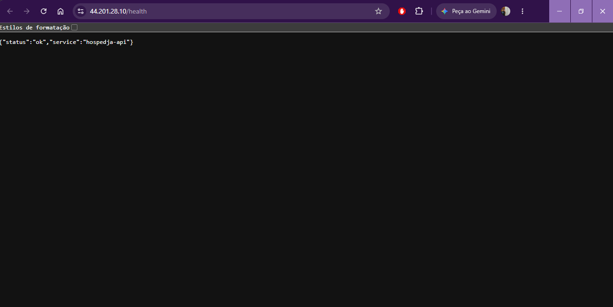
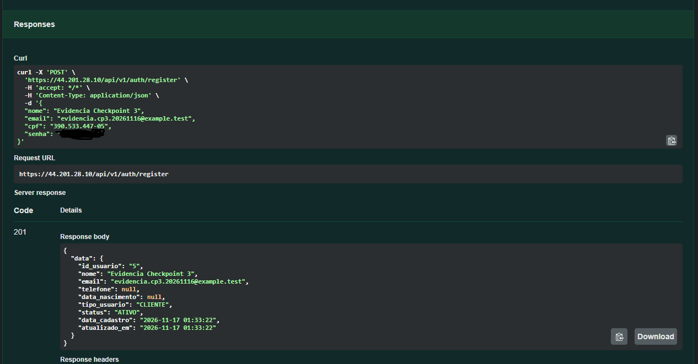
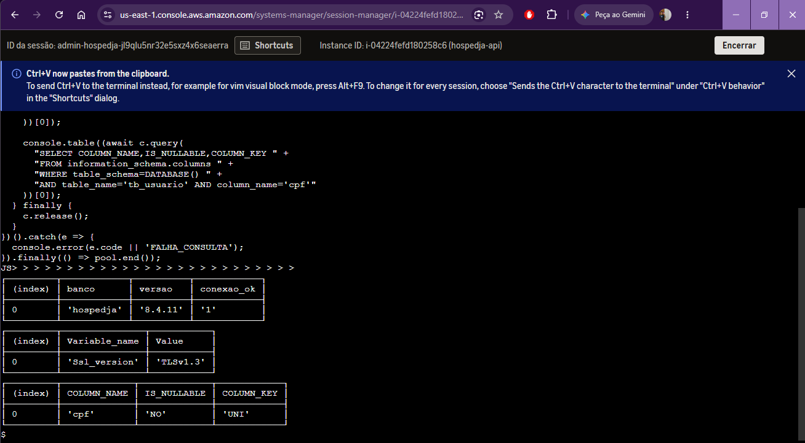
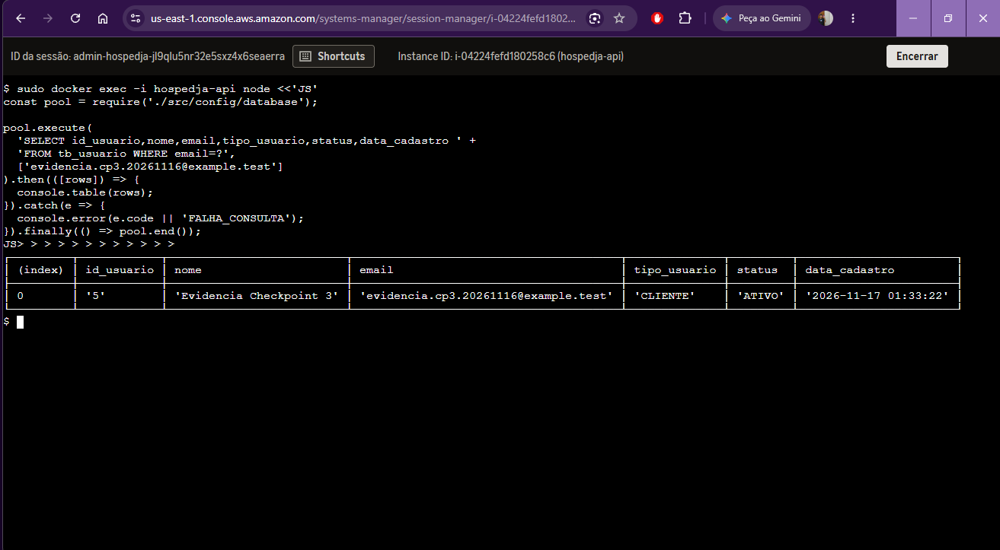
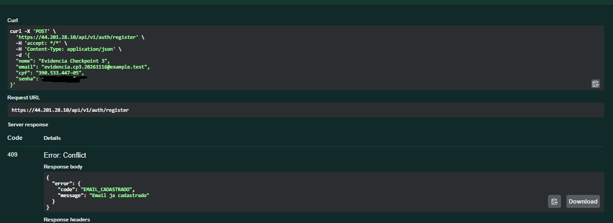
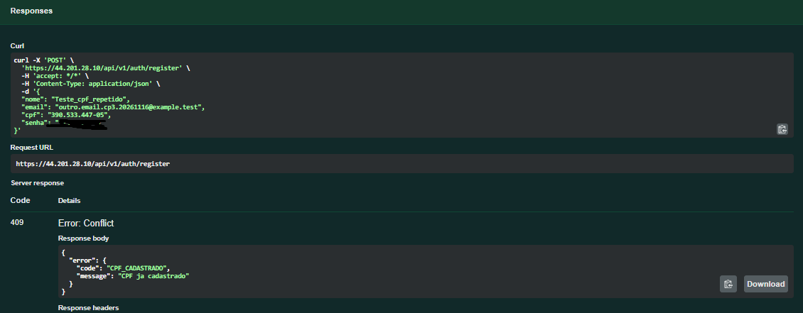
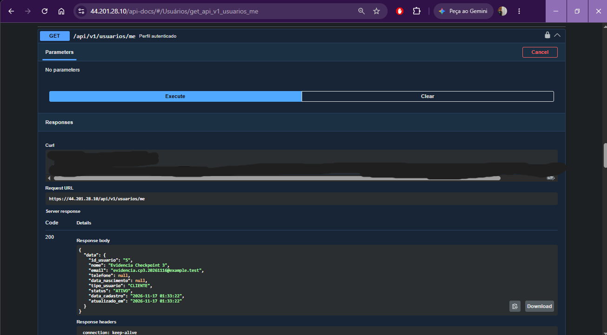
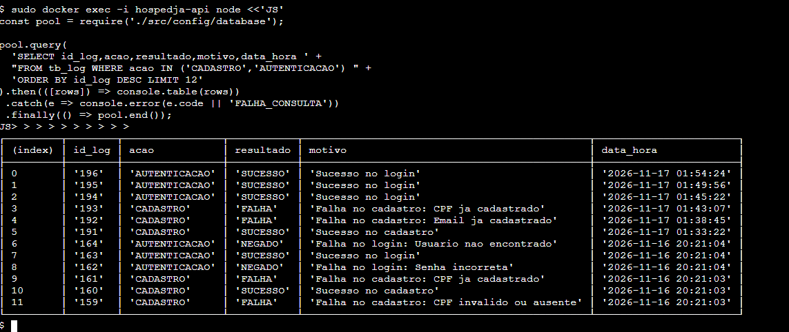
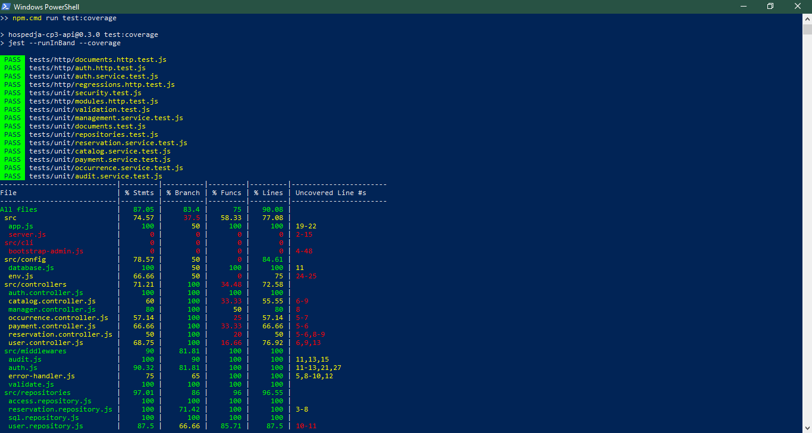
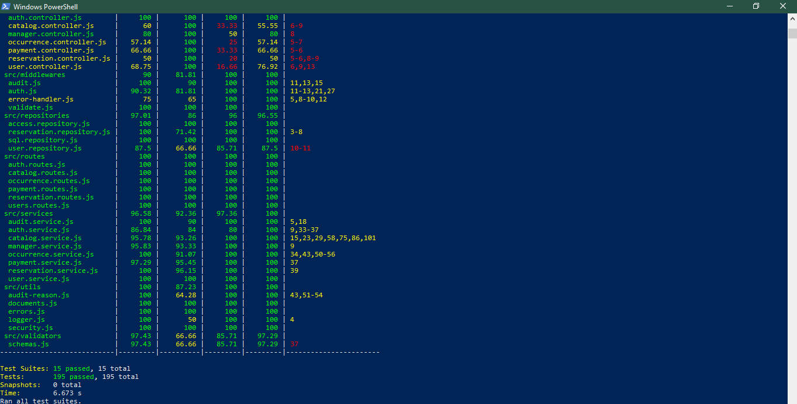

# HospedJá — Documento técnico consolidado — Checkpoint 3

Projeto de Software 2 · UNIUBE · CodeSync · Grupo 3

**Data:** 16/11/2026. **Versão da aplicação:** 0.3.0.

**Finalidade:** registrar a construção do backend, a modelagem e a persistência no banco, a implantação na nuvem, as regras implementadas, os resultados verificados e o trabalho necessário para concluir o produto. Este relatório consolida a documentação técnica do Checkpoint 3, atualizada em 16/11/2026.

**Integrantes:** Luiz Felipe Ferraresso; Joao Lucas; Vitor; Enzo; Igor.

**Matéria:** Projeto de Software 2. **Turma:** 11.

**Professor:** MARCUS ARTIAGA COLANTONI.

**Responsável pelas evidências:** Luiz Felipe Ferraressso.

**Identificação das evidências:** as capturas reais da execução estão inseridas na seção 14, com legendas, data de 16/11/2026 e identificação do responsável. Os ambientes local e AWS são identificados em cada registro.

## 1. Visão geral e estado do projeto

O HospedJá é um projeto de plataforma de hospedagens e serviços de guias. A implementação atual oferece uma API REST para autenticação, usuários, catálogo de hospedagens, tipos de quarto, guias, rascunhos de reservas, registros preliminares de pagamentos e ocorrências com análise humana. Também oferece auditoria e documentação interativa.

O backend e o banco estão hospedados na AWS e funcionam independentemente do computador dos integrantes. O frontend ainda será desenvolvido. O Swagger é a interface técnica de testes da API; ele não equivale à interface final de clientes, gestores e atendimento.

| Entrega | Situação em 16/11/2026 |
|---|---|
| Backend REST | Implementado e implantado em EC2, dentro de contêiner Docker |
| Persistência relacional | RDS MySQL privado, acessado pela aplicação com TLS |
| Cadastro e login | Implementados; cadastro exige CPF válido e único; login usa e-mail e senha |
| Catálogo | CRUD de hotéis, tipos de quarto e guias, com restrições de perfil e propriedade |
| Reservas | Rascunhos PENDENTE, edição de observações e cancelamento restrito |
| Pagamentos | Registro administrativo preliminar; não realiza cobrança nem estorno |
| Ocorrências | Registro e análise humana; não aplica penalidade automaticamente |
| Logs | Auditoria de requisições mutantes em tb_log e Winston, com motivo específico |
| Frontend, pesquisa e venda completa | Pendentes; detalhados na seção 12 |

**Acessos publicados:** saúde da API: https://44.201.28.10/health ; Swagger: https://44.201.28.10/api-docs/ ; contrato OpenAPI: https://44.201.28.10/openapi.json . O prefixo dos endpoints de negócio é `/api/v1`.

O endereço é um IP público da EC2. Ele pode mudar se a instância for parada e iniciada novamente, pois não foi estabelecido um endereço estável como parte desta entrega. Os resultados e versões deste documento correspondem à consulta de 16/11/2026.

## 2. Arquitetura e organização do código

A API foi desenvolvida em JavaScript com CommonJS, executada pelo Node.js. O Express organiza os endpoints e middlewares. A separação de responsabilidades facilita manutenção, testes e evolução.

```text
Navegador / Swagger / cliente HTTP
                 | HTTPS
             Nginx na EC2
                 | loopback 127.0.0.1:3000
           API Express em Docker
                 | mysql2 + TLS
          RDS MySQL privado

Requisição -> middlewares -> routes -> controllers -> services
                                              -> repositories / pool
Resposta concluída -> auditoria -> tb_log + Winston
```

| Camada / diretório | Responsabilidade efetivamente implementada |
|---|---|
| src/routes | Associa método/caminho a autenticação, autorização, validação e controller |
| src/controllers | Extrai parâmetros, chama serviços e define corpo/status da resposta |
| src/services | Aplica regras de negócio, propriedade de registros e transações |
| src/repositories | Reúne consultas reutilizáveis e operações SQL parametrizadas |
| src/validators | Define schemas Zod, limites, campos permitidos e validação de documentos |
| src/middlewares | Autenticação, autorização, auditoria, validação e tratamento de erros |
| src/config | Valida ambiente e configura pool MySQL e TLS |
| src/utils | Hash de senha, JWT, erros, validação CPF/CNPJ, motivos de log e logger |
| database | Schema, seed local, verificação e migrações |
| tests / tdd | Testes unitários, HTTP, MySQL e laboratório didático de TDD |
| aws / scripts | Implantação, migração, preflight e verificações de entrega |
| src/docs/openapi.yaml | Contrato publicado pelo Swagger |

A separação não é absoluta: alguns serviços usam o pool diretamente para consultas e transações. A auditoria também escreve diretamente no banco. Portanto, o projeto usa uma arquitetura em camadas, sem alegar que todo acesso passa obrigatoriamente por um repositório.

`app.js` exporta a aplicação sem abrir uma porta, permitindo testes HTTP. `server.js` verifica o banco antes de iniciar o servidor e trata desligamento por SIGINT/SIGTERM. O projeto contém seis diagramas editáveis em Draw.io e fontes DOT sobre camadas, autenticação, auditoria, reservas/pagamentos, ocorrências e componentes.

## 3. Tecnologias e versões utilizadas

As versões abaixo foram obtidas do contêiner implantado, do host EC2 e do `package-lock.json`. Faixas como `^4.21.2`, declaradas no package.json, não representam necessariamente a versão instalada. O lockfile e o inventário da imagem são a referência para a reprodução desta entrega.

### 3.1. Execução e infraestrutura

| Tecnologia | Versão / identificação | Utilização e origem da informação |
|---|---|---|
| Node.js na AWS | 22.23.5 | Runtime efetivo do contêiner implantado |
| npm na AWS | 10.9.9 | Instalação das dependências por npm ci |
| MySQL no RDS | 8.4.11 | Banco efetivo de hospedagem e persistência |
| InnoDB | Integrado ao MySQL 8.4.11 | Engine das 40 tabelas; transações e integridade referencial |
| Ubuntu da EC2 | 24.04.5 LTS | Sistema operacional consultado no host |
| Docker Engine da EC2 | 29.1.3 | Construção e execução dos contêineres |
| Docker Buildx | 0.30.1 | Construção com recursos BuildKit |
| Nginx | 1.24.0, pacote Ubuntu | Proxy reverso HTTP/HTTPS |
| Git na EC2 | 2.43.0 | Identificação da release e controle do checkout |
| AWS CLI na EC2 | 2.35.21 | Acesso operacional via IAM role |
| AWS CLI do operador | 2.39.1 | Comandos de implantação executados nesta atualização |
| Certbot | Imagem certbot/certbot:v5.4.0 | Versão registrada na configuração HTTPS de 29/10; não reconsultada nesta rodada |
| TLS entre API e RDS | TLSv1.3 | Consultado na conexão real da aplicação |
| Cifra do banco | TLS_AES_256_GCM_SHA384 | Consultada na mesma conexão TLS |
| OpenAPI | 3.0.3 | Versão do formato do contrato da API |
| Aplicação HospedJá | 0.3.0 | Identificação no package.json |

AWS EC2, RDS, VPC, Security Groups, IAM, Systems Manager, Parameter Store, Secrets Manager e GitHub Actions são serviços gerenciados. Não recebem uma versão de software fixada pelo projeto como uma biblioteca npm. A versão do engine MySQL e as versões das ferramentas operacionais são registradas separadamente.

O Dockerfile usa a tag `node:22-alpine`; a tag é móvel, enquanto a consulta acima identifica o runtime efetivamente implantado. O Compose é utilizado nos arquivos de ambiente local e de testes; o plugin Docker Compose não estava disponível no host EC2 consultado, onde o deploy usa comandos Docker diretamente.

### 3.2. Bibliotecas do backend e testes

| Pacote | Versão exata | Função |
|---|---|---|
| express | 4.22.3 | Servidor HTTP, roteamento e middlewares |
| zod | 4.6.7 | Validação e normalização de entradas e ambiente |
| mysql2 | 3.24.6 | Driver MySQL, pool, consultas parametrizadas e transações |
| bcrypt | 6.0.0 | Hash e comparação de senhas |
| jsonwebtoken | 9.0.3 | Emissão e verificação de JWT |
| helmet | 8.3.0 | Cabeçalhos de proteção HTTP |
| cors | 2.8.6 | Tratamento de origens permitidas |
| express-rate-limit | 7.5.1 | Limite de tentativas de cadastro/login |
| dotenv | 16.6.1 | Leitura de variáveis do arquivo de ambiente |
| winston | 3.19.0 | Registro de eventos e falhas operacionais |
| swagger-ui-express | 5.0.1 | Publicação da interface Swagger |
| swagger-ui-dist | 5.34.0 | Interface visual Swagger, dependência transitiva registrada no lockfile |
| yamljs | 0.3.0 | Leitura do contrato YAML |
| jest | 29.7.0 | Testes e cobertura; dependência de desenvolvimento |
| supertest | 7.3.1 | Testes HTTP da aplicação; dependência de desenvolvimento |

As 12 dependências diretas de produção foram conferidas na imagem; Jest e Supertest foram identificados no lockfile e não fazem parte da instalação de produção. O arquivo `Inventario_Dependencias_2026-11-16.csv`, entregue junto ao relatório, detalha as 419 entradas do lockfile, incluindo pacotes transitivos e caminhos duplicados por versão/posição. Esse total não significa 419 tecnologias de negócio independentes.

### 3.3. Ambientes de desenvolvimento e validação

O ambiente local desta revisão utilizou Node.js 24.22.1. A instância isolada de MySQL usada nos 16 testes de integração foi 9.6.0. Os arquivos Compose mantêm MySQL 8.0 para desenvolvimento/integração e MySQL 8.4 para compatibilidade com AWS. A CI solicita Node.js 22 e MySQL 8.0. Essas diferenças são declaradas para não confundir ambiente local com o RDS 8.4.11 efetivamente hospedado.

O GitHub Actions possui jobs de sintaxe/integridade/cobertura e integração MySQL. Usa `actions/checkout@v4`, `actions/setup-node@v4` e `actions/upload-artifact@v4`. A existência do workflow não comprova que a versão atual foi executada nele: a CI desta atualização não foi disparada nesta sessão.

### 3.4. Ferramentas de documentação e artefatos

O repositório também possui ferramentas para a entrega acadêmica. Elas não são dependências da API em produção.

| Ferramenta | Versão / referência | Uso |
|---|---|---|
| Python do gerador anterior | Imagem python:3.12-slim-bookworm | Pipeline do PDF consolidado de outubro |
| ReportLab / Pillow | 4.4.3 / 11.3.0 | Versões fixadas no pipeline anterior de PDF e imagens |
| PyMuPDF / charset-normalizer anteriores | 1.26.4 / 3.4.3 | Versões fixadas na validação do PDF anterior |
| Graphviz | Executável sem versão inventariada nesta rodada | Renderização das fontes DOT dos diagramas |
| Draw.io | Metadado de arquivo 24.7.17 | Arquivos editáveis; a versão do aplicativo do aluno não foi consultada |
| Python desta geração | 3.15.2 | Geração de Word/HTML pela biblioteca padrão |
| Google Chrome desta geração | 157.0.8103.78 | Impressão do HTML em PDF, em modo headless |
| pypdf / PyMuPDF desta revisão | 7.1.0 / 2.1 | Conferência textual e visual do novo PDF, em pasta temporária |

O gerador atual não usa ReportLab/Pillow: produz DOCX e HTML com a biblioteca padrão do Python e imprime o PDF pelo navegador. As ferramentas de inspeção foram instaladas apenas na pasta temporária do trabalho, sem alterar o ambiente npm do backend.

## 4. Banco de dados: modelagem construída

O banco `hospedja` possui 40 tabelas InnoDB, 40 chaves primárias, 14 restrições UNIQUE, 68 chaves estrangeiras e 35 CHECKs. O schema declara ainda 47 índices adicionais explícitos, além dos índices associados a chaves e restrições. O charset é `utf8mb4` e a collation padrão é `utf8mb4_0900_ai_ci`.

As entidades foram separadas por responsabilidade, com relações e tabelas de histórico. A presença de uma tabela não significa que seu fluxo completo já esteja disponível por HTTP.

| Grupo | Tabelas construídas | Uso atual / extensão prevista |
|---|---|---|
| Identidade e endereço de usuário | tb_usuario; tb_endereco_usuario | Usuário ativo na API; endereço ainda sem CRUD próprio |
| Redes, hospedagens e gestão | tb_rede_hoteis; tb_hotel; tb_endereco; tb_admin_hotel | Hotel e vínculo de gestor ativos; rede/endereço sem CRUD completo |
| Catálogo visual e quartos | tb_imagem_hospedagem; tb_tipo_quarto; tb_foto_tipo_quarto; tb_midia_hospedagem | Tipos de quarto ativos; gestão de mídias pendente |
| Preferências e pesquisa | tb_favorito; tb_pesquisa; tb_filtro_pesquisa | Estrutura modelada; APIs e pesquisa por período pendentes |
| Guias | tb_guia | Cadastro, consulta, edição e desativação com autorização |
| Estados de domínio | tb_status_reserva; tb_status_pagamento; tb_status_mensagem | Estados de reserva/pagamento usados; mensagens futuras |
| Reserva e composição | tb_reserva; tb_item_reserva; tb_reserva_hospede; tb_reserva_status | Rascunho e histórico ativos; seleção de itens/hóspedes pendente |
| Pagamento e histórico | tb_pagamento; tb_pagamento_status | Lançamento administrativo interno e histórico, sem gateway |
| Serviço de guia e avaliações | tb_reserva_guia; tb_avaliacao_guia; tb_avaliacao_hospedagem | Estruturas modeladas; fluxos HTTP pendentes |
| Atendimento e mensagens | tb_atendimento; tb_mensagem; tb_atendimento_historico | Base do SAC/chatbot; APIs e integração pendentes |
| Ocorrências e penalidades | tb_ocorrencia; tb_penalidade | Ocorrência e análise ativas; aplicação de penalidade pendente |
| Auditoria transversal | tb_log | Registro efetivo de eventos da API |
| Auditorias setoriais | tb_log_rede_hotel; tb_log_hotel; tb_log_admin_hotel; tb_log_tipo_quarto; tb_log_reserva; tb_log_pagamento; tb_log_mensagem; tb_log_penalidade | Modeladas; não há preenchimento automático universal pela API atual |

### 4.1. Tipos e tratamento dos dados

IDs de entidades usam principalmente BIGINT UNSIGNED. A API transporta esses IDs como strings para preservar valores acima do limite seguro do Number do JavaScript. As tabelas de status usam chaves pequenas e códigos únicos. Favoritos usam chave primária composta por usuário e hotel.

Valores monetários usam DECIMAL, principalmente DECIMAL(12,2). O driver está configurado com `decimalNumbers: false`, evitando conversão automática para ponto flutuante na leitura. Isso não significa que o cálculo de preços definitivo já exista: a cotação ainda precisa ser implementada.

Datas de estadia usam DATE; eventos e históricos usam DATETIME com valores padrão de cadastro/atualização. A conexão trabalha com timezone `Z` e retorna datas como strings. O check-in futuro é comparado no backend à data UTC; alinhar explicitamente a regra de calendário do negócio ao fuso adotado é um ponto da evolução.

Campos ENUM restringem perfis, categorias, status, métodos e tipos de evento. JSON é usado em dados flexíveis, como comodidades e detalhes sanitizados de auditoria. Textos têm comprimentos definidos; a API aplica limites antes da persistência.

## 5. Persistência, integridade e migrações

### 5.1. Restrições e relacionamentos

| Mecanismo | Implementação e efeito |
|---|---|
| NOT NULL | Campos obrigatórios, incluindo tb_usuario.cpf, rejeitam ausência no banco |
| UNIQUE | E-mail, CPF, códigos e combinações relevantes impedem duplicação |
| FOREIGN KEY | Relacionamentos referenciam registros existentes e definem comportamento de exclusão |
| CHECK | Datas, notas, valores, coordenadas, capacidade, documentos e coerência de alvos |
| Índices | Apoiam consultas por usuário/data, hotel/status, período e recurso de auditoria |
| DEFAULT e timestamps | Definem estados iniciais e momentos de cadastro/alteração |
| InnoDB e transações | Confirmam ou revertem conjuntos de escritas relacionados |

Há três estratégias de exclusão conforme o relacionamento: RESTRICT protege registros referenciados de negócio; CASCADE remove dependentes estritamente associados, como endereço ou imagem; SET NULL preserva histórico quando o vínculo pode desaparecer. Em `tb_log`, excluir um usuário remove seu vínculo, preservando o evento.

Exemplos de CHECKs: checkout posterior ao check-in; quantidade de hóspedes e capacidade positivas; valores não negativos; avaliação entre 1 e 5; latitude entre -90 e 90; longitude entre -180 e 180; preço máximo não inferior ao mínimo. Ocorrência deve possuir exatamente o alvo compatível com CLIENTE, HOTEL ou GUIA.

### 5.2. CPF e CNPJ

`tb_usuario.cpf` é `CHAR(11) NOT NULL`, possui índice UNIQUE e valida os dois dígitos verificadores por CHECK. A API aceita 11 dígitos ou máscara completa, preserva zeros iniciais e grava apenas os dígitos. Recusa sequências repetidas e não remove caracteres arbitrários para transformar uma entrada inválida em válida.

O e-mail é normalizado para minúsculas e validado na API. O banco garante unicidade e possui CHECK para o armazenamento em minúsculas. A verificação de formato do e-mail está na API, não é uma prova de existência da caixa postal.

O CNPJ está em `tb_admin_hotel`, associado ao vínculo de gestor/hospedagem. Continua opcional; quando fornecido, precisa ter formato e dígitos verificadores válidos. A API aceita o formato numérico e o alfanumérico, normaliza máscara/letras e o banco exige o valor canônico. Omitir o CNPJ ao atualizar o vínculo preserva o valor; enviar null o remove.

A validação do CNPJ alfanumérico aplica módulo 11 com valor ASCII menos 48. A conferência matemática de CPF/CNPJ não consulta titularidade, existência ou situação cadastral na Receita Federal. O [manual técnico da Receita](https://www.gov.br/receitafederal/pt-br/centrais-de-conteudo/publicacoes/documentos-tecnicos/cnpj/manual-dv-cnpj.pdf) é a referência do cálculo de CNPJ.

### 5.3. Acesso e consistência transacional

O mysql2 mantém um pool de até 10 conexões. Valores são enviados por parâmetros SQL, sem concatenar entradas do usuário. Identificadores dinâmicos são provenientes de configurações internas e passam por validação antes de compor SQL.

Criação de rascunho grava a reserva e seu histórico de status na mesma transação. Registro interno de pagamento grava pagamento e histórico na mesma transação. Cancelamento também altera estado e registra histórico conjuntamente. Falhas geram rollback; conexões são liberadas em finally.

Pagamento e cancelamento utilizam `SELECT ... FOR UPDATE` na mesma reserva antes de decidir a alteração. Essa serialização evita os cenários concorrentes cobertos pelos testes entre lançamento e cancelamento. Ainda não representa controle de estoque por intervalo de hospedagem.

### 5.4. Evolução do schema

`database/01_schema.sql` cria uma base nova. `database/02_seed.sql` contém dados fictícios exclusivos de desenvolvimento/homologação. `aws/02_status_basicos.sql` prepara os estados mínimos sem cadastrar usuários de demonstração no RDS.

| Migração | Alteração |
|---|---|
| 001_token_version | Acrescenta a versão de sessão usada para revogar tokens após troca de senha |
| 002_documentos_e_motivo_log | Exige CPF, valida dígitos de CPF/CNPJ e acrescenta motivo ao log |

`npm run db:migrate` usa um lock no banco para evitar execução simultânea, verifica documentos existentes e reconhece etapas já aplicadas. Quando há documento ausente/inválido, a etapa 002 é interrompida para correção dos dados reais. Não são inventados documentos para completar registros.

DDL do MySQL possui commit implícito; por isso, o comando permite retomada por etapa, mas não promete rollback transacional de toda a migração. Criar novamente tabelas com IF NOT EXISTS não atualiza uma estrutura antiga: é necessário executar as migrações.

## 6. Regras de negócio implementadas no backend

### 6.1. Autenticação, cadastro e usuário

| Regra | Comportamento atual |
|---|---|
| Cadastro público | Cria exclusivamente CLIENTE; não aceita promoção de perfil pelo corpo |
| Dados únicos | CPF e e-mail repetidos são recusados; o banco mantém a proteção contra concorrência |
| Identificação | CPF obrigatório e validado no cadastro público, equipe e bootstrap de administrador |
| Senha nova | Mínimo de 10 caracteres e máximo de 72 bytes UTF-8; armazenamento por hash bcrypt |
| Login | E-mail e senha; só conta ATIVO autentica |
| Falha de login | Resposta pública genérica; causa específica registrada internamente |
| Sessão | JWT HS256 com sub, sv, emissor hospedja e audiência hospedja-api |
| Autorização | Perfil e situação da conta consultados no banco a cada autenticação |
| Troca de senha | Exige a senha atual; troca hash e incrementa token_version no mesmo UPDATE condicional |
| Revogação | Tokens com versão antiga deixam de autenticar após troca de senha |
| Próprio perfil | Permite alterar nome, telefone e nascimento; não libera CPF/e-mail/perfil pela edição comum |
| Gestão da equipe | Apenas ADMIN cadastra GUIA, GESTOR_HOSPEDAGEM e OPERADOR_SAC |
| Situação da conta | ADMIN aplica somente ATIVO, INATIVO ou BLOQUEADO |

O token tem expiração padrão de 1 hora, configurável no ambiente. A aplicação utiliza comparação bcrypt também quando o usuário não é encontrado, reduzindo diferenças triviais de processamento. Não há fluxo de recuperação por e-mail nem logout com lista individual de revogação; essas evoluções precisam ser definidas.

### 6.2. Hospedagens, quartos, gestores e guias

Somente ADMIN cria hotéis e guias. Tipos de quarto podem ser cadastrados por ADMIN ou por GESTOR_HOSPEDAGEM com vínculo ativo ao hotel. Gestores alteram apenas hospedagens/quartos sob sua gestão e não podem alterar campos administrativos de rede/status do hotel.

Vincular gestor exige hotel existente e usuário GESTOR_HOSPEDAGEM ativo. Vincular novamente reativa o vínculo; desvincular o desativa e registra a data, preservando a linha. A autorização posterior verifica `ativo=1`.

Consultas públicas mostram hotéis ATIVO, quartos DISPONIVEL de hotel ativo e guias ATIVO/APROVADO. ADMIN possui visão mais ampla; a consulta individual também considera a propriedade autorizada. O filtro é aplicado antes da paginação. As listas do catálogo aceitam limit de 1 a 100 e offset de 0 a 1.000.000.

Guia INTERNO exige usuário vinculado com perfil GUIA; guia EXTERNO não recebe esse acesso vinculado. O guia interno pode editar o próprio registro dentro dos campos autorizados, sem alterar aprovação, status ou documento reservado ao administrador. Dados privados do guia são retirados da consulta pública.

As operações DELETE do catálogo realizam desativação lógica: hotel/guia fica INATIVO e quarto fica INDISPONIVEL. A desativação de hotel exige ADMIN. A quantidade_disponivel do tipo de quarto é um atributo cadastral; não é um calendário de ocupação.

### 6.3. Reservas e pagamentos

| Regra | Implementação e limite |
|---|---|
| Acesso à reserva | Proprietário ou ADMIN lê/edita a reserva |
| Datas | Datas reais, checkout posterior e check-in futuro |
| Rascunho | Criado como PENDENTE, com valor_total e taxas em zero |
| Identificador | Código único HJ com componente aleatório; não significa confirmação comercial |
| Edição | Somente observações de rascunho PENDENTE |
| Cancelamento | Somente PENDENTE sem qualquer pagamento vinculado |
| Pagamento interno | Exclusivo de ADMIN; exige reserva existente e PENDENTE |
| Histórico | Reserva/pagamento mantêm registro de mudança de status na mesma transação |
| Dados externos | Identificador de transação externa não é exposto ao cliente |

Não foram implementados seleção definitiva de quartos, cotação, bloqueio de estoque, confirmação comercial, integração Mercado Pago, webhook, cobrança, estorno ou regra de pagamento em até sete dias. O campo provedor MERCADO_PAGO modelado no banco não significa comunicação ativa com esse serviço.

### 6.4. Ocorrências e análise humana

Usuário autenticado pode registrar ocorrência contra CLIENTE, HOTEL ou GUIA existente. A autoria fica associada ao usuário. Quando uma reserva é informada, são verificados propriedade e vínculos: o hotel deve fazer parte dos itens, o cliente deve corresponder ao proprietário e o guia deve corresponder ao serviço vinculado.

O autor consulta seus registros; ADMIN tem acesso administrativo. Somente ADMIN analisa a ocorrência, informando texto, estado e identidade do analista. Ocorrência ENCERRADA não pode ser novamente analisada por esse fluxo. A análise não cria penalidade nem bloqueia automaticamente uma pessoa.

Os perfis GUIA e OPERADOR_SAC já existem como papéis. A existência do perfil OPERADOR_SAC não significa que os fluxos de atendimento estejam implementados.

## 7. API REST e contratos disponíveis

O OpenAPI contém 40 operações documentadas: 38 de negócio e duas de saúde/contrato. O Swagger é servido separadamente em `/api-docs/`. O padrão de sucesso de negócio é `{data: ...}` e o de erro é `{error: {code, message}}`; saúde e troca de senha possuem exceções próprias.

| Recurso | Operações principais | Permissão |
|---|---|---|
| /health | GET; executa SELECT 1 antes de responder | Público |
| /openapi.json e /api-docs/ | Contrato JSON e documentação interativa | Público |
| /auth/register, /auth/login | POST cadastro e autenticação | Público, com rate limit |
| /auth/password | PATCH senha | Autenticado |
| /usuarios/me | GET e PATCH perfil próprio | Autenticado |
| /usuarios e /usuarios/{id} | Listar, cadastrar equipe e obter perfil | ADMIN |
| /usuarios/{id}/status | PATCH situação | ADMIN |
| /hoteis, /quartos, /guias | GET lista/detalhe; POST; PATCH; DELETE lógico | Consulta pública; escrita conforme perfil/propriedade |
| /hoteis/{id}/gestores | POST vínculo e DELETE vínculo individual | ADMIN |
| /reservas | GET, POST rascunho, GET detalhe, PATCH observações, DELETE cancelamento | Proprietário/ADMIN conforme operação |
| /pagamentos | GET lista/detalhe e POST registro interno | Leitura própria/ADMIN; criação ADMIN |
| /ocorrencias | GET lista/detalhe e POST registro | Autor/ADMIN conforme operação |
| /ocorrencias/{id}/analise | PATCH análise humana | ADMIN |

Códigos mais usados: 200 consulta/edição; 201 criação; 204 troca de senha; 400 JSON inválido; 401 autenticação; 403 permissão; 404 inexistência; 409 duplicidade/conflito de estado; 413 corpo excessivo; 422 validação; 429 limite de tentativas; 500 falha interna.

O contrato OpenAPI deve continuar sendo refinado, principalmente nos schemas detalhados de respostas e nos fluxos futuros. Ter uma página Swagger acessível não comprova por si só que todos os requisitos do produto foram concluídos.

## 8. Auditoria, erros e rastreabilidade

O middleware acompanha POST, PUT, PATCH e DELETE. Após a resposta, encaminha um evento ao serviço de auditoria com ação, operação, entidade, registro quando identificado, resultado, usuário/perfil quando autenticado, IP e metadados permitidos. GET não é auditado por esse middleware, e `/health` é excluído.

`tb_log` possui chave, usuário opcional, perfil, ação, operação, entidade, registro, resultado, origem, motivo, detalhes JSON, IP e data/hora. O resultado é SUCESSO para respostas abaixo de 400, NEGADO para 401/403 e FALHA para outros erros.

### 8.1. Especificidade do erro solicitada no Checkpoint 3

Foi adicionada `motivo VARCHAR(500) NOT NULL`. O texto vem de mensagens controladas pelo servidor, não da cópia de uma mensagem arbitrária ou de todo o corpo enviado pelo usuário.

| Evento | Motivo registrado |
|---|---|
| CPF ausente ou inválido | Falha no cadastro: CPF invalido ou ausente |
| CPF já utilizado | Falha no cadastro: CPF ja cadastrado |
| E-mail já utilizado | Falha no cadastro: Email ja cadastrado |
| Senha de login incorreta | Falha no login: Senha incorreta |
| Usuário de login inexistente | Falha no login: Usuario nao encontrado |
| Conta indisponível | Falha no login: Conta indisponivel |
| CNPJ inválido no vínculo | Falha no vinculo de gestor: CNPJ invalido |
| Autenticação concluída | Sucesso no login |

O login permanece por e-mail; por isso, a falha de CPF aparece no cadastro ou no fluxo que recebe esse documento. Para não inventar a causa de eventos passados, logs antigos receberam `Evento sem motivo informado`.

Os detalhes JSON aceitos na auditoria são método, rota resumida e status HTTP. Não são copiados senha, JWT, e-mail ou CPF para motivo/detalhes. IP e vínculo com usuário continuam sendo dados de auditoria previstos na tabela e precisam de política de acesso/retenção.

### 8.2. Limites da auditoria

A gravação em tb_log é best-effort, após a resposta: uma falha não desfaz a operação de negócio. Winston registra falhas e eventos sanitizados. Não há atomicidade entre toda operação e seu log nem preenchimento universal das tabelas setoriais por triggers. A auditoria HTTP é feita pelo Node.js. Evoluções previstas: auditoria crítica com outbox ou outra garantia transacional, retenção e monitoramento.

## 9. Segurança e proteção de dados implementadas

Schemas Zod são estritos: campos desconhecidos são recusados. IDs, textos, datas, horários, quantidades e valores têm limites compatíveis com SQL. O corpo JSON tem limite de 100 kb. Erros são padronizados, e mensagens internas/segredos não são devolvidos ao cliente.

Senhas usam hash bcrypt, com custo configurável de 10 a 15 e padrão 12; não há armazenamento de senha em texto puro. JWT usa HS256, segredo mínimo de 32 caracteres, expiração e conferência de versão da sessão. Hash, token_version e CPF não aparecem no perfil público retornado pela API.

Cadastro e login compartilham limite de 15 requisições por IP em janela de 15 minutos. CORS utiliza lista de origens; Helmet define cabeçalhos de proteção. A política CSP tem exceção restrita à interface Swagger, necessária ao seu conteúdo inline. Atrás de Nginx, o ambiente configura a quantidade de proxies confiáveis.

O MySQL fica privado. Apenas a aplicação possui caminho de rede autorizado ao banco. A porta da API no host é publicada em loopback; o acesso externo ocorre pelo Nginx em HTTPS. A conexão ao RDS usa CA configurada e `rejectUnauthorized: true`, com TLSv1.3 confirmado nesta revisão.

O usuário de aplicação mantém permissões de dados sem receber ALTER permanente para deploy. Segredos ficam em Parameter Store/arquivo protegido no servidor; o segredo administrativo do RDS só foi usado temporariamente, em memória, para migração. Não há credenciais no documento.

Esses controles não equivalem a uma certificação de segurança nem encerram o trabalho: ainda precisam ser definidos recuperação de senha, retenção/privacidade, ensaios de carga, recuperação de backup e tratamento de integrações externas.

## 10. Hospedagem, implantação e operação

Na AWS, foi reutilizada a EC2 `hospedja-api` na região us-east-1 e o RDS `hospedja-db`, privado e criptografado conforme o registro operacional. Não foi criada outra infraestrutura para repetir o deploy.

O Dockerfile separa estágios de teste e produção, instala pacotes com npm ci/lockfile e executa a API com usuário `node`. O healthcheck consulta `/health`. O processo da API verifica o MySQL ao iniciar; se não consegue conectar, não anuncia uma inicialização normal.

O deploy prepara código isolado, identifica a imagem pela revisão, valida schema/configuração/estados básicos e testa um candidato antes da promoção. O contêiner anterior fica preservado. Falhas de promoção têm mecanismo de recuperação do contêiner anterior; a recuperação do banco exige estratégia própria e não é resolvida apenas pela troca da imagem.

| Evidência operacional | Registro desta atualização |
|---|---|
| Revisão implantada | 5fa7f2ebc6aa18ac695539feb12045a8956730b5 |
| Snapshot anterior às alterações | hospedja-pre-documentos-20261116, confirmado available |
| Estado final da aplicação | healthy, usuário node e zero reinícios na conferência do deploy |
| Schema | Migração 002 aplicada e preflight aprovado |
| HTTPS | Health, Swagger e OpenAPI consultados após publicação |
| Acesso temporário de migração | Permissão restrita ao segredo deste RDS, removida após conclusão |

Havia uma conta antiga de demonstração sem CPF. Sua exclusão foi autorizada pelo operador após conferir ausência de vínculos de negócio e disponibilidade do snapshot. Seus dois logs foram preservados. Não foram preenchidos documentos fictícios em contas reais.

A revisão da imagem identifica o snapshot de código preparado na release da EC2. Isso não representa um push ou merge desse commit no GitHub. A publicação/revisão do conjunto de alterações no repositório da equipe continua como etapa de controle de versão.

A configuração HTTPS de 29/10 registrou certificado de IP com renovação automatizada. Um endereço estável, acompanhamento da renovação e ensaio de restauração permanecem itens operacionais importantes. Nenhum backup foi restaurado como parte desta revisão.

## 11. Testes realizados e alcance das evidências

| Verificação | Resultado registrado | Alcance |
|---|---|---|
| Unitários e HTTP | 195 testes; 15 suítes aprovadas | Regras, validações, serviços, repositórios simulados e rotas |
| Cobertura de linhas | 90,08% de src | Resultado da última rodada de cobertura desta atualização |
| Integração local | 16 testes; 3 suítes aprovadas | MySQL 9.6.0 isolado, sem executar contra o RDS |
| Verificações operacionais AWS | 22 aprovadas | Fluxos pontuais na API implantada, schema, documentos, logs e TLS |
| Sintaxe e integridade | Sem problemas na execução registrada | JavaScript, imports, tabelas e YAML |
| Migração em base antiga | Aprovada em base isolada | Bloqueio de documentos inválidos, retomada e preservação de dados |
| Schema e seed | Executados em base isolada | Construção completa com documentos de teste válidos |

Os testes cobrem também revogação de sessão, restrições de perfil/propriedade, dados públicos protegidos, cancelamento com pagamento, coerência das ocorrências e concorrência entre cancelamento e lançamento interno. A migração foi reexecutada com sucesso sem repetir alterações já aplicadas.

No RDS, foram confirmados NOT NULL/UNIQUE, CHECKs ativos, recusa de CPF nulo/duplicado/inválido por SQL, recusa de CNPJ inválido, aceitação de CNPJ alfanumérico e persistência dos motivos do log. O smoke test criou usuário temporário removido ao final; alterações auxiliares de CNPJ foram revertidas em transação.

Os resultados comprovam os cenários executados. Não comprovam pagamento comercial, estoque por período, frontend, segurança completa, desempenho sob carga, recuperação de desastre ou funcionalidades ainda ausentes. O laboratório TDD existente é didático e posterior à implementação inicial; não constitui evidência de que todo o histórico foi desenvolvido primeiro por testes.

## 12. Próximos passos para concluir o projeto

A finalização depende de completar um fluxo de uso de ponta a ponta, além de manter os controles já implementados. A sequência abaixo organiza dependências e critérios verificáveis, sem atribuir prazos ou responsáveis que ainda não foram definidos pela equipe.

| Prioridade / etapa | Trabalho necessário | Critério de conclusão |
|---|---|---|
| 1. Fechar entrega técnica | Revisar alterações, publicar no repositório e executar CI; identificação e evidências já incluídas neste relatório | Revisão identificada e checks aprovados no repositório da equipe |
| 2. Definir contratos do produto | Revisar requisitos, telas, permissões e estados com a equipe | Backlog e critérios de aceite confirmados; OpenAPI coerente |
| 3. Frontend inicial | Construir login/cadastro, catálogo, detalhe, perfil e interfaces por papel | Telas responsivas consumindo a API publicada e exibindo erros corretos |
| 4. Pesquisa e disponibilidade | Destino, datas, capacidade, filtros, calendário/estoque e consultas por intervalo | Busca retorna opções válidas e impede venda acima do estoque |
| 5. Reserva completa | Seleção de itens/hóspedes, cotação no servidor, taxas, validade e confirmação | Fluxo consistente com preço calculado pelo backend e concorrência testada |
| 6. Pagamento real | Mercado Pago em ambiente de teste, webhook validado, idempotência, conciliação e estorno | Cobrança/status/estorno rastreáveis sem duplicação; regra dos sete dias implementada e testada |
| 7. Guias e avaliações | Disponibilidade, reserva de guia interno, contato autorizado e avaliações após uso | Somente participantes elegíveis reservam/avaliam; vínculos consistentes |
| 8. SAC e IA | APIs de atendimento/mensagem, DeepSeek, histórico e transferência ao operador | Usuário acompanha atendimento; operador acessa apenas dados autorizados |
| 9. Penalidades manuais | Decisão administrativa após análise, histórico e revisão da penalidade | Sem punição automática; autorizações e justificativas verificáveis |
| 10. Robustez operacional | Auditoria crítica, observabilidade, carga, endereço estável e restauração de backup | Alertas e restauração ensaiados; critérios de desempenho e retenção definidos |
| 11. Homologação final | Testes ponta a ponta, acessibilidade, segurança, privacidade e aceite dos cenários | Jornada completa aprovada em ambiente equivalente ao publicado |

Recuperação de senha/verificação de e-mail e bootstrap da primeira conta administrativa devem integrar o planejamento de acesso. Gestão de endereços, imagens, favoritos e dados auxiliares precisa ser concluída quando suas telas forem implementadas. O aplicativo mobile pertence ao escopo futuro se mantido nos requisitos da equipe.

As integrações Mercado Pago e DeepSeek devem começar em ambiente de teste, com credenciais próprias e cenários de falha. Banco modelado, enum de provedor ou tabela de mensagens não substituem a implementação da integração.

## 13. Como reproduzir o ambiente e consultar o projeto

Para trabalho local, use as instruções do repositório. `node scripts/setup-local-env.js` prepara ambiente local sem substituir um arquivo existente; depois, `docker compose up --build -d --wait` inicia os serviços locais. As URLs locais usam localhost e não substituem as evidências de nuvem pedidas pelo professor.

```bash
npm ci
npm run check
npm run integrity
npm test
npm run test:coverage
```

Integração deve usar base isolada conforme `compose.integration.yaml` ou `compose.aws-validation.yaml`. Não executar `test:db`, seed fictício ou roteiros de limpeza genérica no RDS. Para migração de um ambiente hospedado, seguir o procedimento operacional com backup e usuário de migração apropriado.

### 13.1. Fontes deste relatório

As fontes primárias são `package.json`, `package-lock.json`, `Dockerfile`, `compose*.yaml`, `.github/workflows/backend-tests.yml`, `database/01_schema.sql`, migrações, serviços/repositórios/middlewares e `src/docs/openapi.yaml`.

Os registros operacionais estão em `docs/DEPLOY_AWS_2026-10-29.md` e `docs/ATUALIZACOES_2026-11-16.md`. Os resultados desta consulta foram salvos em `entrega/evidencias/inventario_aws_2026-11-16.json`; o inventário completo de dependências está no CSV que acompanha o documento. O inventário JSON contém metadados e amostras sanitizadas de motivos, sem senhas, tokens ou documentos pessoais.

Documentos antigos datados de outubro registram o estado de suas respectivas revisões e podem mencionar itens que já foram atualizados. Para situação atual, este relatório e o registro de 16/11 prevalecem sobre descrições históricas de hospedagem pendente.

## 14. Evidências de funcionamento da API e do banco de dados

Esta seção reúne dez capturas reais fornecidas por Luiz Felipe Ferraressso, documentando a execução de testes do Checkpoint 3 em 16/11/2026. As imagens foram inseridas com suas proporções originais, incluindo as ocultações de credenciais realizadas pelo responsável. As consultas de conexão e persistência foram executadas na instância que hospeda a API, usando a configuração de banco da aplicação.

As Figuras 01 a 08 registram operações na aplicação e no banco hospedados na AWS. As Figuras 09 e 10 registram os testes unitários/HTTP e sua cobertura, executados no computador local. A comparação entre as Figuras 02 e 04 comprova a persistência do mesmo cadastro, identificado pelo usuário ID 5.

A data de identificação das evidências é 16/11/2026, no horário de Brasília. Os campos de data/hora retornados pelo banco usam UTC; por exemplo, 17/11/2026 às 01:33:22 UTC corresponde a 16/11/2026 às 22:33:22 em Brasília. Essa diferença de fuso explica a data exibida em algumas capturas.

| Figura | Operação registrada | Evidência principal |
|---|---|---|
| 01 | Saúde da API publicada | Resposta status ok no endereço público |
| 02 | Cadastro pelo Swagger | HTTP 201, usuário ID 5 criado |
| 03 | Conexão e estrutura do banco | MySQL, TLS, CPF NOT NULL e UNIQUE |
| 04 | Consulta do cadastro no RDS | Mesmo ID/e-mail retornado pela API |
| 05 | Tentativa de e-mail duplicado | HTTP 409 EMAIL_CADASTRADO |
| 06 | Tentativa de CPF duplicado | HTTP 409 CPF_CADASTRADO |
| 07 | Perfil autenticado | GET /usuarios/me, HTTP 200 |
| 08 | Consulta aos logs | Motivos específicos persistidos |
| 09 | Testes e cobertura global | Arquivos com PASS e cobertura de linhas de 90,08% |
| 10 | Resumo dos testes | 15 suítes e 195 testes aprovados |

### Figura 01 — API publicada e resposta do endpoint de saúde



**Legenda:** acesso ao endereço público `44.201.28.10/health`, com retorno `status: ok` e identificação `hospedja-api`. O endpoint executa SELECT 1 no MySQL antes de responder. A captura registra a resposta da aplicação na nuvem e sua conectividade básica com o banco; o código HTTP não está explicitamente exibido nessa imagem.

**Data:** 16/11/2026. **Responsável:** Luiz Felipe Ferraressso. **Ambiente:** AWS — endpoint público.

### Figura 02 — Cadastro de usuário realizado pela API



**Legenda:** execução de POST `/api/v1/auth/register` no Swagger da aplicação publicada. O servidor retornou HTTP 201 e criou o usuário ID 5, nome Evidencia Checkpoint 3, perfil CLIENTE e status ATIVO. A senha enviada foi ocultada na captura. O ID e o e-mail serão comparados com a consulta ao RDS da Figura 04.

**Data:** 16/11/2026. **Responsável:** Luiz Felipe Ferraressso. **Ambiente:** AWS — API publicada / Swagger.

### Figura 03 — Conexão ao MySQL, TLS e restrições do CPF



**Legenda:** consultas executadas pelo Node.js dentro do contêiner da API, por sessão SSM na EC2. O resultado identifica o banco hospedja, MySQL 8.4.11, conexao_ok igual a 1 e TLSv1.3. A coluna cpf apresenta IS_NULLABLE NO e COLUMN_KEY UNI, comprovando as restrições NOT NULL e UNIQUE na estrutura hospedada.

**Data:** 16/11/2026. **Responsável:** Luiz Felipe Ferraressso. **Ambiente:** AWS — EC2 e RDS privado.

### Figura 04 — Persistência do cadastro no banco hospedado



**Legenda:** consulta parametrizada à tb_usuario pelo e-mail de demonstração. O banco retornou o usuário ID 5, nome Evidencia Checkpoint 3, e-mail evidencia.cp3.20261116@example.test, perfil CLIENTE e status ATIVO. A correspondência com a resposta HTTP 201 da Figura 02 demonstra que o cadastro recebido pela API foi persistido no RDS. A consulta não seleciona senha_hash nem CPF.

**Data:** 16/11/2026. **Responsável:** Luiz Felipe Ferraressso. **Ambiente:** AWS — consulta ao RDS pela configuração da API.

### Figura 05 — Recusa de cadastro com e-mail repetido



**Legenda:** nova tentativa de cadastro com o e-mail já utilizado. A API respondeu HTTP 409, código EMAIL_CADASTRADO e mensagem Email ja cadastrado. A captura demonstra a aplicação da regra de unicidade do e-mail antes de concluir um segundo cadastro.

**Data:** 16/11/2026. **Responsável:** Luiz Felipe Ferraressso. **Ambiente:** AWS — API publicada / Swagger.

### Figura 06 — Recusa de cadastro com CPF repetido



**Legenda:** tentativa de cadastro com um e-mail diferente e o mesmo CPF de demonstração já utilizado. A API respondeu HTTP 409, código CPF_CADASTRADO e mensagem CPF ja cadastrado. A troca do e-mail permite demonstrar especificamente a regra de unicidade do CPF, sem que a checagem anterior de e-mail interrompa o teste.

**Data:** 16/11/2026. **Responsável:** Luiz Felipe Ferraressso. **Ambiente:** AWS — API publicada / Swagger.

### Figura 07 — Leitura do perfil de usuário autenticado



**Legenda:** execução de GET `/api/v1/usuarios/me` após autenticação. O retorno HTTP 200 apresenta o mesmo usuário ID 5, com nome, e-mail, perfil CLIENTE e status ATIVO. O bloco que contém a credencial Bearer foi ocultado pelo responsável, mantendo visíveis o endpoint e o corpo da resposta. A captura comprova o acesso autorizado ao próprio perfil.

**Data:** 16/11/2026. **Responsável:** Luiz Felipe Ferraressso. **Ambiente:** AWS — API publicada / Swagger.

### Figura 08 — Persistência de motivos específicos na auditoria



**Legenda:** consulta à tb_log com filtro de ações CADASTRO e AUTENTICACAO, exibindo ID, resultado, motivo e data/hora. Os registros mostram falhas por Email ja cadastrado e CPF ja cadastrado, além de autenticações concluídas e falhas de login. O salto visual entre IDs 164 e 191 é efeito do filtro: os 26 registros intermediários existem e pertencem a outras ações, conforme conferência somente de leitura no RDS.

**Data:** 16/11/2026. **Responsável:** Luiz Felipe Ferraressso. **Ambiente:** AWS — consulta à auditoria persistida no RDS.

### Figura 09 — Execução dos testes e cobertura global



**Legenda:** execução local de `npm.cmd run test:coverage`, utilizando Jest com cobertura. Os arquivos de teste exibem PASS. A linha All files registra 87,05% de cobertura de instruções, 83,40% de ramificações, 75,00% de funções e 90,08% de linhas. A tabela também identifica componentes com cobertura parcial, úteis ao planejamento de evolução dos testes.

**Data:** 16/11/2026. **Responsável:** Luiz Felipe Ferraressso. **Ambiente:** local — Windows PowerShell, testes unitários/HTTP.

### Figura 10 — Resumo final da suíte automatizada



**Legenda:** continuação do resultado da mesma execução apresentada na Figura 09. O resumo confirma 15 suítes aprovadas de 15, 195 testes aprovados de 195 e duração de 6,673 segundos. Esta captura complementa a visão da cobertura e identifica explicitamente a conclusão bem-sucedida dos testes locais; não representa a execução da suíte diretamente contra o RDS.

**Data:** 16/11/2026. **Responsável:** Luiz Felipe Ferraressso. **Ambiente:** local — Windows PowerShell, testes unitários/HTTP.
