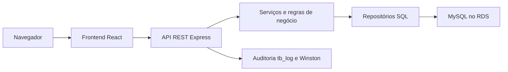

# HospedJá — entregas e plano de conclusão do projeto

**Data de referência:** 18/11/2026.

**Projeto:** HospedJá / CodeSync — Projeto de Software 2, turma 11.

**Professor:** MARCUS ARTIAGA COLANTONI.

**Equipe:** Luiz Felipe Ferraresso, Joao Lucas, Vitor, Enzo e Igor.

**Branch desta etapa:** `feat/frontend-figma`.

Este documento consolida o que está construído, o que foi verificado e o que falta no banco de dados, backend, frontend e hospedagem. As funcionalidades descritas como pendentes são trabalho futuro; uma tabela modelada ou uma tela existente no Figma não comprova a implementação do fluxo completo.

## 1. Situação geral

| Camada | Entregue | Limite atual |
| --- | --- | --- |
| Banco | MySQL com 40 tabelas, relacionamentos, restrições, migrações, CPF obrigatório/único, validação de CPF/CNPJ e motivo de auditoria | Diversas estruturas ainda não possuem serviços e telas que utilizem seus dados |
| Backend | API REST com autenticação, perfis, catálogo, vínculos de gestores, rascunhos de reservas, lançamentos internos de pagamentos e ocorrências | Reserva comercial completa, disponibilidade por período, pagamentos externos, SAC e outros fluxos ainda pendentes |
| Frontend | Primeira interface integrada ao contrato da API, baseada na exportação do Figma Make | Implementação local; ainda não publicada na AWS e com composição de celular centralizada no desktop |
| Nuvem | Backend hospedado em EC2 e banco privado em RDS, com HTTPS e conexão TLS ao MySQL | A nova versão que inclui o frontend ainda precisa passar pela implantação |
| Qualidade | Testes unitários, HTTP, banco isolado em etapas anteriores e testes de navegador nesta etapa | Testes de navegador usam API interceptada; falta homologação dos fluxos completos com banco real e validação da nova imagem Docker |
| Entrega acadêmica | PDF do Checkpoint 3, documento editável, diagramas e capturas reais da etapa de backend/banco | O PDF de 16/11 é histórico: não contém o frontend desenvolvido em 18/11 |

**O produto completo ainda não está finalizado.** Cadastro, autenticação e recursos iniciais estão construídos; a experiência de selecionar uma hospedagem, reservar um quarto e pagar exige as próximas etapas descritas abaixo.

## 2. Arquitetura e ambientes



No desenvolvimento, o Vite serve o frontend e encaminha `/api` à API configurada. O arquivo local ignorado `frontend/.env.local` aponta para a API AWS existente. Também é possível configurar uma API e um banco locais para desenvolvimento isolado.

A preparação para produção compila o frontend em `frontend/dist`. O Express passa a servir o HTML em `/` e os assets em `/assets`, mantendo `/api/v1` para os serviços. O Dockerfile inclui essa compilação e copia o resultado para a imagem final. A proposta mantém frontend e API na mesma origem, atrás do Nginx existente, com o banco privado.

Essa preparação está no código; **não foi realizada uma nova publicação na AWS nesta etapa**.

### Endereços e recursos existentes

| Recurso | Identificação |
| --- | --- |
| API hospedada | `https://44.201.28.10` |
| Saúde da API e conexão com banco | `https://44.201.28.10/health` — executa `SELECT 1` |
| Documentação interativa | `https://44.201.28.10/api-docs/` |
| Contrato OpenAPI | `https://44.201.28.10/openapi.json` |
| Região AWS | `us-east-1` — Norte da Virgínia |
| EC2 | `hospedja-api` |
| RDS | `hospedja-db`, MySQL 8.4.11 no inventário de 16/11 |
| Frontend local | `http://127.0.0.1:5173/` |

Em 18/11, o health e as listagens públicas de hotéis, quartos e guias responderam HTTP 200. As três listagens retornaram vazias. O estado vazio na interface representa o retorno real da API nessa consulta.

## 3. Banco de dados — o que foi construído

### 3.1 Modelagem e persistência

- [x] Schema em `database/01_schema.sql`, com 40 tabelas InnoDB.
- [x] Codificação `utf8mb4` e collation `utf8mb4_0900_ai_ci`.
- [x] Chaves primárias e estrangeiras, unicidade, índices e restrições `CHECK`.
- [x] Inventário remoto de 16/11: 40 PKs, 14 restrições UNIQUE, 68 FKs e 35 CHECKs.
- [x] Campos de data/hora e históricos para rastreabilidade das alterações de estado.
- [x] Valores monetários definidos no schema com tipos decimais.
- [x] Regras de integridade referencial com `RESTRICT`, `CASCADE` e `SET NULL` conforme o relacionamento.
- [x] Seed com dados fictícios para desenvolvimento e script de verificação da estrutura.
- [x] SQL parametrizado nos repositórios da API e tratamento de erros de integridade.
- [x] Transações e bloqueios nos fluxos que coordenam reserva, pagamento interno e cancelamento.

### 3.2 Inventário das 40 tabelas e uso atual

| Domínio | Tabelas | Uso atual |
| --- | --- | --- |
| Identidade — 2 | `tb_usuario`, `tb_endereco_usuario` | Usuário usado por cadastro, autenticação e perfil; endereço do usuário ainda sem fluxo completo de API/tela |
| Hospedagens e catálogo — 9 | `tb_rede_hoteis`, `tb_hotel`, `tb_endereco`, `tb_admin_hotel`, `tb_imagem_hospedagem`, `tb_tipo_quarto`, `tb_foto_tipo_quarto`, `tb_midia_hospedagem`, `tb_favorito` | Hotel, tipo de quarto e vínculo de gestor usados pela API; rede, endereço, mídias e favoritos ainda sem integração completa na interface |
| Pesquisas — 2 | `tb_pesquisa`, `tb_filtro_pesquisa` | Persistência modelada; pesquisa por destino/datas e filtros especializados ainda pendentes |
| Guias — 1 | `tb_guia` | Catálogo e manutenção autorizada; contratação ainda pendente |
| Status — 3 | `tb_status_reserva`, `tb_status_pagamento`, `tb_status_mensagem` | Status de reserva/pagamento utilizados; mensagem ainda sem serviço de atendimento ativo |
| Reservas, pagamentos e avaliações — 9 | `tb_reserva`, `tb_item_reserva`, `tb_reserva_hospede`, `tb_reserva_status`, `tb_pagamento`, `tb_pagamento_status`, `tb_reserva_guia`, `tb_avaliacao_guia`, `tb_avaliacao_hospedagem` | Reserva preliminar, pagamento interno e respectivos históricos utilizados; itens/quartos, hóspedes detalhados, reserva de guia e avaliações ainda sem fluxo completo |
| Atendimento — 3 | `tb_atendimento`, `tb_mensagem`, `tb_atendimento_historico` | Modelagem existente; SAC, mensagens e DeepSeek ainda sem API funcional |
| Ocorrências e penalidades — 2 | `tb_ocorrencia`, `tb_penalidade` | Registro e análise humana de ocorrências implementados; aplicação de penalidades pendente |
| Auditoria — 9 | `tb_log`, `tb_log_rede_hotel`, `tb_log_hotel`, `tb_log_admin_hotel`, `tb_log_tipo_quarto`, `tb_log_reserva`, `tb_log_pagamento`, `tb_log_mensagem`, `tb_log_penalidade` | Auditoria transversal ativa em `tb_log`; tabelas setoriais modeladas, sem afirmar preenchimento automático de todas elas |

### 3.3 CPF e CNPJ

- [x] `tb_usuario.cpf` definido como `CHAR(11) NOT NULL` e protegido por UNIQUE.
- [x] Formato e os dois dígitos verificadores do CPF validados na API e por CHECK no banco.
- [x] Preservação dos zeros iniciais; armazenamento sem máscara.
- [x] Rejeição de CPF repetido, incompleto, com dígitos incorretos ou caracteres indevidos.
- [x] CNPJ validado no vínculo `tb_admin_hotel`, incluindo formatos numérico e alfanumérico.
- [x] CNPJ armazenado sem máscara, com letras maiúsculas quando aplicável; validação também por CHECK.
- [x] CNPJ permanece opcional: omitir preserva o valor do vínculo existente; enviar `null` remove o valor.
- [x] Cadastro público de cliente, criação administrativa de equipe e bootstrap de administrador exigem CPF válido.

A validação matemática não consulta situação cadastral, existência ou titularidade do documento na Receita Federal. Não há consulta cadastral externa implementada.

### 3.4 Logs e migrações

- [x] Nova coluna `tb_log.motivo VARCHAR(500) NOT NULL`.
- [x] Causas específicas, como CPF/e-mail duplicado, CPF inválido e senha incorreta, sem copiar documentos ou credenciais para o log.
- [x] Valor neutro para logs históricos sem causa conhecida, sem inventar explicações retroativas.
- [x] Migração `001_token_version` para revogação de sessões após mudança de senha.
- [x] Migração `002_documentos_e_motivo_log` para documentos e motivo da auditoria.
- [x] Runner de migração com lock, reconhecimento das etapas já aplicadas e bloqueio quando existem documentos pendentes.
- [x] Preflight que confere as restrições necessárias antes da promoção da aplicação.
- [x] Snapshot `hospedja-pre-documentos-20261116` confirmado disponível antes das alterações de 16/11.
- [x] Conta antiga de teste sem CPF removida com autorização expressa, sem vínculos de negócio, preservando os dois logs.

MySQL pode fazer commit implícito em DDL. As migrações têm retomada por etapas; isso não significa rollback transacional de todos os comandos `ALTER TABLE`.

### 3.5 Banco — o que falta fazer

- [ ] Definir e implementar inventário de quartos por período, com proteção contra reservas concorrentes e overbooking.
- [ ] Integrar `tb_item_reserva` e os hóspedes ao processo de reserva completa, com preservação dos valores negociados.
- [ ] Revisar a persistência de cotação, expiração, disponibilidade e confirmação conforme as regras finais da equipe.
- [ ] Integrar fotos, endereço/localização e demais dados de catálogo ao contrato público.
- [ ] Persistir favoritos por usuário usando a estrutura existente; hoje o frontend mantém apenas estado em memória.
- [ ] Implementar persistência operacional de contratação/agenda de guias, avaliações, SAC e penalidades por meio dos respectivos serviços.
- [ ] Rever as necessidades de tabelas/colunas para recuperação de senha, 2FA, notificações e futuras integrações, criando migrações quando necessárias.
- [ ] Definir retenção, minimização/anonimização e acesso aos logs e dados pessoais.
- [ ] Ensaiar restauração de backup em ambiente isolado e registrar o resultado.
- [ ] Medir consultas e concorrência com volume representativo; ajustar índices com base nos planos de execução.
- [ ] Cadastrar dados de catálogo pelo fluxo administrativo autorizado, sem executar seed fictício no RDS de produção.

**Nenhuma alteração nova de schema foi feita na etapa de frontend de 18/11.** As restrições implantadas em 16/11 permanecem a base de persistência atual.

## 4. Backend — o que foi construído

### 4.1 Estrutura e contratos

- [x] API REST em Node.js/Express, organizada em rotas, controladores, serviços e repositórios.
- [x] Configuração validada por ambiente; credenciais fora do código versionado.
- [x] Validação Zod de corpos, parâmetros e paginação, com rejeição de campos não permitidos.
- [x] Respostas padronizadas com `data` ou `error.code`/`error.message`.
- [x] Swagger e OpenAPI para consulta dos contratos atuais.
- [x] Tratamento de JSON inválido, limite de corpo de 100 KB e erros de integridade do banco.
- [x] CORS com origens configuradas, Helmet e limite de tentativas de autenticação.
- [x] SQL parametrizado, IDs tratados sem perda de precisão numérica e catálogo paginado.

### 4.2 Regras de negócio implementadas

| Área | Regra construída |
| --- | --- |
| Cadastro | Cadastro público cria CLIENTE; exige CPF válido e e-mail normalizado; trata duplicidade de e-mail/CPF |
| Senhas | Hash bcrypt; novas senhas com no mínimo 10 caracteres e limite de 72 bytes UTF-8; verificação da senha atual para alterar |
| Login | E-mail e senha; conta precisa estar ativa; falhas de credenciais são genéricas para o público |
| Sessão | JWT com versão de sessão; troca de senha invalida os tokens anteriores; papel e status são consultados no banco |
| Perfis | CLIENTE, GUIA, GESTOR_HOSPEDAGEM, OPERADOR_SAC e ADMIN; permissões aplicadas no servidor |
| Perfil próprio | Usuário consulta e atualiza somente nome, telefone e data de nascimento; CPF não é devolvido nas respostas de usuário |
| Administração de usuários | ADMIN cria contas de equipe e altera status de usuários conforme os contratos existentes |
| Catálogo público | Hotéis ativos, quartos disponíveis de hotéis ativos e guias ativos/aprovados; dados privados de guias protegidos na visão pública |
| Manutenção de catálogo | ADMIN cadastra hotéis/guias; gestor modifica hospedagem/quartos aos quais está vinculado; guia altera campos permitidos do próprio cadastro |
| Vínculo de gestor | ADMIN vincula/desvincula gestor da hospedagem; CNPJ opcional validado no vínculo |
| Rascunho de reserva | Exige autenticação, check-in futuro segundo data UTC, saída posterior à entrada e quantidade válida de hóspedes; inicia PENDENTE, com total e taxas zero |
| Consulta de reserva | Dono ou ADMIN; não permite consultar reserva de outro cliente |
| Alteração de reserva | Somente observações de rascunhos pendentes no contrato atual |
| Cancelamento | Somente rascunho PENDENTE e sem pagamento; transação e bloqueio coordenam a operação com os lançamentos internos |
| Pagamento interno | Criação exclusiva de ADMIN em reserva pendente; lançamento preliminar e histórico, sem transação em gateway |
| Consulta de pagamento | Dono da reserva ou ADMIN; identificadores externos privados não são expostos ao cliente |
| Ocorrências | Autor, alvo e vínculos de reserva/guia precisam ser coerentes; consulta pelo autor ou ADMIN |
| Análise de ocorrência | ADMIN registra análise humana e estado; nenhuma penalidade é aplicada automaticamente |
| Auditoria | Registra ações mutantes, usuário quando identificado, operação, resultado, motivo e horário; falhas de autenticação distinguem causas apenas internamente |

A auditoria atual é **best-effort**: sua gravação não faz parte de uma garantia transacional conjunta com toda alteração de negócio. Os logs não devem ser apresentados como prova de persistência garantida de todos os eventos em qualquer falha.

### 4.3 Rotas disponíveis

| Grupo | Recursos atuais |
| --- | --- |
| `/api/v1/auth` | Cadastro, login e troca de senha |
| `/api/v1/usuarios` | Perfil próprio e operações administrativas de usuários |
| `/api/v1/hoteis` | Catálogo/manutenção autorizada e vínculos de gestores |
| `/api/v1/quartos` | Catálogo e manutenção autorizada de tipos de quarto |
| `/api/v1/guias` | Catálogo e manutenção autorizada de guias |
| `/api/v1/reservas` | Listagem/detalhe, criação preliminar, observações e cancelamento restrito |
| `/api/v1/pagamentos` | Consulta autorizada e criação administrativa de lançamento interno |
| `/api/v1/ocorrencias` | Registro, consulta e análise administrativa |

O [OpenAPI](../src/docs/openapi.yaml) e a [documentação de rotas e permissões](ROTAS_E_PERMISSOES.md) detalham campos, métodos e respostas.

### 4.4 Alterações de backend para receber o frontend

- [x] Middleware `src/middlewares/frontend.js` serve o build na mesma origem.
- [x] HTML sem cache e assets com nomes gerados pelo build e cache prolongado.
- [x] URLs inexistentes da API continuam retornando 404 JSON; não recebem HTML por fallback.
- [x] CSP específica das páginas: scripts apenas da mesma origem, sem JavaScript inline, com exceções de estilos/fontes/imagens necessárias ao design.
- [x] Backend continua utilizável quando o frontend não está compilado.
- [x] Dockerfile com etapa separada de compilação e cópia do frontend para a imagem final.

### 4.5 Backend — o que falta fazer

- [ ] Pesquisa por destino, período e hóspedes, com filtros e paginação apropriados no servidor.
- [ ] Agregação pública de endereço, fotos, comodidades e valores, sem expor dados privados.
- [ ] Seleção de hotel/quarto, cotação, inventário por período e confirmação transacional de reserva.
- [ ] Regras de expiração, pagamento até sete dias antes da chegada e demais transições definitivas de reserva.
- [ ] Mercado Pago em ambiente de testes, webhooks autenticados, idempotência, reconciliação e tratamento de falhas.
- [ ] Cancelamento de reserva confirmada e estorno conforme política definida.
- [ ] API de favoritos persistidos por usuário.
- [ ] Reserva/agenda de guias, contato permitido de guias externos e avaliação após uso elegível.
- [ ] Autocadastro/avaliação de guias e hospedagens, se aprovado como fluxo final, sem permitir autoatribuição indevida de papéis.
- [ ] Recuperação de senha e 2FA antes de habilitar essas experiências no frontend.
- [ ] SAC, mensagens, DeepSeek, histórico, atendimento humano, escalonamento e autorização do operador.
- [ ] Aplicação manual de penalidades após análise humana, com rastreabilidade.
- [ ] Notificações reais e regras de entrega/preferências.
- [ ] Melhorar garantia de auditoria, observabilidade, alarmes, carga e cenários de falha.
- [ ] Ampliar OpenAPI e testes a cada funcionalidade nova, preservando regras de permissão e privacidade.

## 5. Frontend — o que foi construído

### 5.1 Origem e identidade visual

- [x] Exportação ZIP do Figma Make analisada e preservada na pasta local `figma/`.
- [x] Aplicação integrada em `frontend/`, com dependências e lockfile próprios.
- [x] Identidade roxa/laranja, logotipo HospedJá, fontes Sora/Plus Jakarta Sans, splash, onboarding e base visual do login preservados.
- [x] Navegação com HashRouter e menu inferior de início, exploração, guias, reservas e perfil.
- [x] Composição de celular, também centralizada na tela de desktop; testes de ausência de rolagem horizontal em 320, 390 e 1440 pixels.
- [x] Simulações do protótipo não ativadas como operações reais. O ZIP continua como referência para as telas futuras.

### 5.2 Telas e comportamento integrado

| Tela / fluxo | Entregue |
| --- | --- |
| Apresentação | Splash e onboarding com navegação para login |
| Cadastro de cliente | CPF com máscara e validação, e-mail, confirmação de senha, limites compatíveis com a API e mensagens reais de conflito |
| Login | E-mail/senha enviados à API; somente sucesso autentica; visitante pode consultar catálogo sem entrar |
| Sessão | Token da aba, reconsulta de perfil após recarregar, expiração/revogação, logout e bloqueio das rotas protegidas |
| Perfil | Dados retornados pelo servidor; edição de nome, telefone e nascimento; sem perfil, documento ou estatísticas fictícias |
| Segurança | Troca de senha com confirmação; senha atual incorreta preserva a sessão; sucesso exige novo login |
| Hotéis | Consulta da API, filtro local por nome/descrição/categoria, estados de carregamento, vazio e falha com nova tentativa |
| Quartos | Associação ao hotel e detalhes com capacidade, características e diária de referência |
| Guias | Listagem e detalhes públicos com nome, especialidade, área de atuação e valores informados |
| Favoritos | Alternância de hotéis favoritos em memória, limpa na troca de conta; sem persistência no banco |
| Reservas | Listagem, criação de rascunho PENDENTE, protocolo real retornado pela API e cancelamento com confirmação modal |
| Funções futuras | Telas informativas de indisponibilidade para pagamento, 2FA, recuperação de senha, painéis e outras funções ainda sem implementação |

As listagens consultam as páginas do catálogo da API. O filtro atual acontece no navegador e **não representa pesquisa de disponibilidade por datas**. O frontend também filtra estados não publicáveis quando uma conta administrativa consulta o catálogo.

### 5.3 Segurança e experiência

- [x] Requisições com Bearer, tratamento de erros e limite de tempo de 15 segundos.
- [x] Nenhuma repetição automática de operações de escrita que poderia duplicar cadastros ou reservas.
- [x] Token em memória e `sessionStorage` da aba; senha e documentos não são persistidos no navegador.
- [x] A sessão é confirmada pelo backend após recarregar; falha de conexão permite nova tentativa.
- [x] Mensagens de sucesso de cadastro, perfil e senha somente após retorno da operação.
- [x] Nomes acessíveis dos campos, foco visível, link de salto para conteúdo, diálogo modal nativo e respeito à preferência de movimento reduzido.
- [x] Sem coleta de cartão, saque simulado, código de 2FA fictício ou confirmação comercial falsa.
- [x] Imagens ilustrativas identificadas quando a API não fornece fotos; sem notas, promoções ou avaliações inventadas.

O token da aba continua sendo acessível ao JavaScript dessa origem; a escolha de armazenamento não elimina o risco de XSS. A implementação usa restrições de conteúdo e evita persistir credenciais/documentos; não implementa refresh token ou login permanente.

### 5.4 Frontend — o que falta fazer

- [ ] Revisar fidelidade visual, textos e navegação de todas as telas com a equipe.
- [ ] Criar composição específica para desktop/tablet, além da experiência atual de celular centralizada.
- [ ] Validar os fluxos autenticados com API e banco reais em homologação.
- [ ] Integrar busca por destino/datas/hóspedes assim que os contratos de disponibilidade estiverem prontos.
- [ ] Integrar endereço, mapa e fotos reais; revisar dependência de serviços externos para fontes/imagens.
- [ ] Persistir favoritos e carregar a lista do usuário pelo backend.
- [ ] Ativar seleção de quarto, orçamento, checkout e confirmação somente após implementar as regras no backend.
- [ ] Integrar Mercado Pago por fluxo apropriado, sem armazenar dados de cartão diretamente na aplicação.
- [ ] Construir painéis administrativos e de gestor/guia com os dados e permissões reais.
- [ ] Implementar contratação, agenda, avaliações e contato de guias conforme o escopo aprovado.
- [ ] Implementar recuperação de senha, 2FA, notificações e preferências funcionais.
- [ ] Integrar SAC/atendimento humano e as operações de ocorrências que ainda não possuem tela.
- [ ] Implementar política de privacidade/termos definitivos e os processos correspondentes de tratamento de dados.
- [ ] Concluir testes de acessibilidade, navegadores/dispositivos, sessão e persistência ponta a ponta.
- [ ] Publicar a nova versão com frontend e conferir os fluxos por HTTPS na AWS.

## 6. Tecnologias e versões de referência

Os lockfiles registram as versões exatas das dependências. Os números de infraestrutura abaixo vêm do inventário de 16/11; não representam atualização da infraestrutura em 18/11.

| Camada | Tecnologia | Versão de referência |
| --- | --- | --- |
| Banco remoto | MySQL / InnoDB | 8.4.11 |
| Transporte do banco | TLS | 1.3 no inventário remoto |
| Runtime remoto | Node.js / npm | 22.23.5 / 10.9.9 |
| API | Express | 4.22.3 |
| Validação | Zod | 4.6.7 |
| Banco na API | mysql2 | 3.24.6 |
| Senhas / tokens | bcrypt / jsonwebtoken | 6.0.0 / 9.0.3 |
| Proteção HTTP | Helmet / CORS / express-rate-limit | 8.3.0 / 2.8.6 / 7.5.1 |
| Configuração | dotenv | 16.6.1 |
| Auditoria | Winston | 3.19.0 |
| Documentação | swagger-ui-express / yamljs | 5.0.1 / 0.3.0 |
| Testes de API | Jest / Supertest | 29.7.0 / 7.3.1 no lockfile da etapa de backend |
| Interface | React / React DOM | 19.3.1 |
| Rotas | React Router DOM | 7.18.6 |
| Tipagem | TypeScript | 5.9.3 |
| Compilação | Vite / plugin React | 8.3.8 / 6.3.0 |
| Estilos | Tailwind CSS / plugin Vite | 4.3.5 |
| Testes de navegador | Playwright Test | 1.65.1 |
| Ambiente local desta etapa | Node.js | 24.22.1; frontend exige Node >= 22.18 |
| EC2 | Ubuntu | 24.04.5 LTS no inventário |
| Contêiner / proxy | Docker / Nginx | 29.1.3 / 1.24.0 no inventário |

Complementos: [inventário remoto](../entrega/evidencias/inventario_aws_2026-11-16.json), [dependências da entrega anterior](../entrega/Inventario_Dependencias_2026-11-16.csv), [package-lock da API](../package-lock.json) e [package-lock do frontend](../frontend/package-lock.json).

## 7. Testes e evidências

| Verificação | Resultado registrado | Limite |
| --- | --- | --- |
| Backend unitário/HTTP, etapa atual | 198 testes em 16 suítes aprovados | Não executa os fluxos reais de gateway, disponibilidade ou SAC ainda inexistentes |
| Cobertura do backend | 90,28% de linhas | Medida de `src`; não é cobertura do frontend nem prova de todas as regras futuras |
| Frontend unitário | 7 testes aprovados | Documentos, senha, datas e transporte HTTP |
| Frontend no navegador | 10 testes aprovados | API interceptada com dados fictícios; cadastro, conflitos, sessão, perfil, senha, catálogo, favoritos, rascunhos, cancelamento, funções futuras e tamanhos de tela |
| Compilação | TypeScript e build Vite aprovados | Build local; imagem Docker nova ainda não validada |
| Verificações estruturais | `check`, `integrity`, `git diff --check` e checksums aprovados na etapa | Não substituem testes de comportamento |
| Dependências de execução | Auditoria npm sem vulnerabilidades reportadas na API e frontend | Resultado da consulta desta etapa; não é garantia permanente |
| Consulta real à AWS em 18/11 | Health e três catálogos HTTP 200 | Somente leitura; catálogos vazios |
| Navegador local com AWS | HTML local 200, catálogo AWS 200, imagem do onboarding carregada e zero erros JavaScript de página | Não foram submetidos cadastros ou alterações por esse smoke |
| Integração de banco em 16/11 | 16 testes em 3 suítes, MySQL local isolado | Histórico da etapa de documentos/migração; não repetido nesta etapa sem alterações SQL |
| Verificações remotas em 16/11 | 22 verificações operacionais aprovadas | Referentes à versão de backend/banco implantada em 16/11 |
| Pipeline GitHub | Workflow backend existente e workflow frontend acrescentado | A execução remota da nova branch ainda precisa ser acompanhada |
| Docker novo | Não executado | Daemon Docker indisponível nesta máquina |

O PDF de 16/11 contém dez capturas reais do Checkpoint 3, com identificação, legendas, data e responsável. O arquivo é preservado como entrega daquela etapa. As simulações de navegador do frontend não devem ser apresentadas como prova de gravação no RDS.

## 8. Infraestrutura e operação — entregue e pendente

### Entregue

- [x] Hospedagem de API e banco em recursos AWS existentes, sem duplicação da infraestrutura.
- [x] HTTPS no acesso público e TLS entre a aplicação e o banco, conforme as verificações registradas.
- [x] Banco privado, administração por acesso autorizado e segredos fora do repositório.
- [x] Execução da aplicação em contêiner com usuário `node` e healthcheck.
- [x] Procedimento de deploy, preflight, promoção de contêiner e preservação do anterior para recuperação da aplicação.
- [x] Migração aplicada em 16/11 após snapshot; autorização temporária de migração removida ao terminar.
- [x] Lockfiles, scripts de execução/testes e workflows de backend e frontend.
- [x] Atualização do manifesto SHA-256 para contemplar o código entregue e excluir entradas locais/artefatos gerados.

### Pendente

- [ ] Iniciar um daemon Docker autorizado e validar a imagem que contém o frontend.
- [ ] Acompanhar a execução da CI da nova branch, revisar com outro integrante e integrar a mudança conforme o fluxo do repositório.
- [ ] Implantar a nova versão na EC2 existente e validar frontend/API na mesma origem HTTPS.
- [ ] Definir domínio, renovação de certificados e monitoramento operacional conforme a estratégia final de hospedagem.
- [ ] Testar backup/restauração, recuperação da aplicação e procedimentos de incidente.
- [ ] Definir alarmes, métricas, retenção de logs e metas de disponibilidade/desempenho.
- [ ] Separar os testes completos de homologação da base usada para demonstração/produção.

## 9. Ordem recomendada para concluir

Prioridades abaixo são uma proposta de execução, sem estimativas de prazo ou atribuição individual ainda confirmadas.

| Prioridade | Entrega | Banco | Backend | Frontend | Critério de conclusão |
| --- | --- | --- | --- | --- | --- |
| P0 | Homologar e publicar a base atual | Conferir persistência com dados de homologação | Validar imagem, endpoints e permissões | Revisar telas e testar operações reais | Login, perfil e rascunhos funcionando por HTTPS na nova publicação, com evidências reais |
| P0 | Catálogo utilizável | Cadastrar dados autorizados e revisar mídia/endereço | Contrato agregado de detalhes e gestão | Exibir fotos/endereço e catálogo real | Hotel/quarto/guia cadastrado aparece corretamente sem dados de demonstração disfarçados |
| P1 | Pesquisa e disponibilidade | Inventário por período e índices | Busca e concorrência de estoque | Destino, datas, hóspedes e resultados | Reserva concorrente não excede a disponibilidade |
| P1 | Reserva completa | Itens, hóspedes, valores e histórico | Cotação, vínculo, estados e confirmação | Seleção de quarto, revisão e confirmação | Reserva consistente entre tela, API e banco, com valores calculados no servidor |
| P1 | Pagamentos e cancelamento | Eventos e estados conciliados | Mercado Pago, webhooks, idempotência, prazo e estorno | Checkout e acompanhamento de status | Cenários de sucesso, falha, repetição e reembolso aprovados em sandbox |
| P1 | Painéis por perfil | Vínculos e dados coerentes | Permissões e contratos de gestão | Administração, hospedagem e guia | Usuário só consulta/altera recursos permitidos, inclusive em testes negativos |
| P2 | Experiência de guias | Agenda, reservas e avaliações | Contratação, contato e elegibilidade | Busca, agenda e avaliação | Contratação/avaliação persiste e respeita permissões e disponibilidade |
| P2 | SAC e ocorrências | Atendimento, mensagens, histórico e penalidades | DeepSeek, atendimento humano e decisões administrativas | Chat/SAC e telas de ocorrência | Histórico rastreável e intervenção humana antes de penalidades |
| P2 | Conta e preferências | Migrações conforme desenho aprovado | Recuperação, 2FA, favoritos e notificações | Telas com operações reais | Sem códigos, envios ou preferências simulados |
| P2 | Qualidade final e entrega | Restauração e medições | Carga, observabilidade e documentação | Desktop, acessibilidade e navegadores | CI aprovada, homologação concluída e evidências/documentos atualizados |

## 10. Como executar e verificar

### Frontend local

Na raiz do repositório:

```powershell
npm.cmd run web:install
npm.cmd run web:dev
```

Abra `http://127.0.0.1:5173/`. O arquivo local preparado aponta para a API AWS. Operações de cadastro/edição executadas manualmente nessa configuração usam o banco hospedado real. Para desenvolvimento isolado, configure `frontend/.env.local` a partir de `frontend/.env.example` apontando o proxy à API local.

### Testes e compilação

```powershell
npm.cmd run check
npm.cmd run integrity
npm.cmd run test:coverage
npm.cmd run web:test
npm.cmd run web:build
$env:PLAYWRIGHT_EXECUTABLE_PATH='C:\Program Files\Google\Chrome\Application\chrome.exe'
npm.cmd run test:e2e --prefix frontend
npm.cmd run checksums
```

O caminho do Chrome é específico desta máquina. Para outro ambiente, instale o Chromium pelo Playwright e use a configuração padrão. Consulte o [guia do frontend](../frontend/README.md).

### Banco e produção

As instruções de schema, seed, migração e deploy estão no [README principal](../README.md), no [roteiro AWS](../aws/DEPLOY_AWS.md) e no [registro de 16/11](ATUALIZACOES_2026-11-16.md). Seeds fictícios e suítes de integração não devem ser executados na base hospedada de produção. Novas migrações exigem revisão, backup e execução com o acesso adequado.

## 11. Registro da entrega e referências

- Backend/documentos do Checkpoint 3 consolidados na main: commit `66fab2540930cf7152715798a3c7362b6cdf3a31`.
- Documento técnico/PDF com referência ao commit: `63fc88e51cc55eda43be4b0bf0e02963af9932a5`.
- Código da interface, adaptação do backend, testes e este relatório acompanham o commit da etapa `feat/frontend-figma`. Consulte o identificador com `git log -1 --format="%h %s"`; o próprio documento não incorpora o hash do commit que o contém.
- [Fonte técnico do Checkpoint 3](DOCUMENTO_TECNICO_CHECKPOINT3_2026-11-16.md).
- [PDF do Checkpoint 3](../entrega/HospedJa_Documento_Tecnico_Checkpoint3_2026-11-16.pdf).
- [Detalhes da atualização e migração de 16/11](ATUALIZACOES_2026-11-16.md).
- [Implementação, execução e testes do frontend](../frontend/README.md).
- [Matriz histórica de requisitos do CP2](MATRIZ_REQUISITOS_CP2.md), datada de 28/10; seus estados antigos devem ser lidos junto deste relatório atual.
- [Guia de contribuição e revisão](../CONTRIBUTING.md).

Este relatório não declara merge, push, implantação, restauração ou execução de CI que ainda não tenham sido realizados. Atualize os estados e acrescente evidências conforme cada próxima etapa for concluída.
